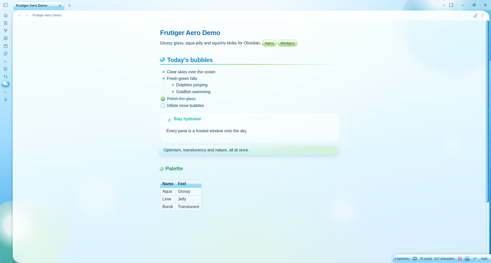
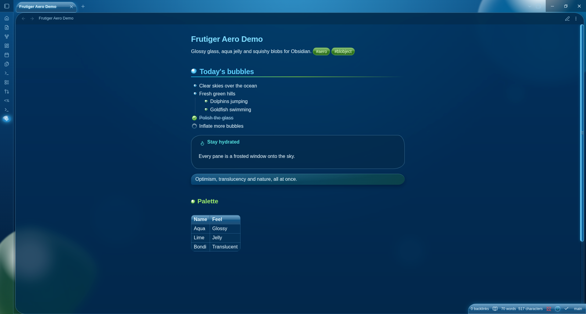

# Frutiger Aero for Obsidian

A CSS snippet that turns Obsidian into a glossy, bubbly **Frutiger Aero** world, with a little **blobject** squish on top.

Night aqua (dark mode)

## Features

- **Sky & ocean backdrop:** sky-to-sea gradient with glossy bubbles and a grassy glow
- **Frosted glass panes** with rounded, pebble-like corners
- **Aqua jelly buttons** that turn green and squish on hover
- **Floating lava-lamp blobs** in translucent Bondi-blue and lime plastic
- **Blobject details:** jelly-bean bullets, checkboxes and tags, blob heading markers, wobbling ribbon icons, candy-tinted callouts, speech-bubble quotes
- **Solid aqua scrollbars** with XP-style grip ridges
- **Soft caption buttons** with a rounded red close button
- **Light & dark:** bright daytime sky, plus a glowing "night aqua" deep-ocean dark mode
- Follows your system color scheme
- Respects `prefers-reduced-motion`

## Install

### As a theme (recommended)

**From Obsidian:** Settings → Appearance → Themes → **Manage** → search for **Frutiger Aero** → **Install and use**.

**Manually:**
1. Create the folder `.obsidian/themes/Frutiger Aero/` in your vault.
2. Put `theme.css` and `manifest.json` from this repo inside it.
3. Choose **Frutiger Aero** under Settings → Appearance → Themes.

### As a CSS snippet

Prefer to keep your current theme? Copy `frutiger-aero.css` into `.obsidian/snippets/`, then enable **frutiger-aero** under Settings → Appearance → CSS snippets. It works best on top of the default theme, since other themes may override some colors.

### Light and dark

Set Settings → Appearance → **Base color scheme** to **Adapt to system** to switch between the daytime sky and night aqua automatically.

### Fonts

Uses Frutiger or Segoe UI if you have them installed, falling back to Myriad Pro, Nunito, or Ubuntu.

## License

MIT
